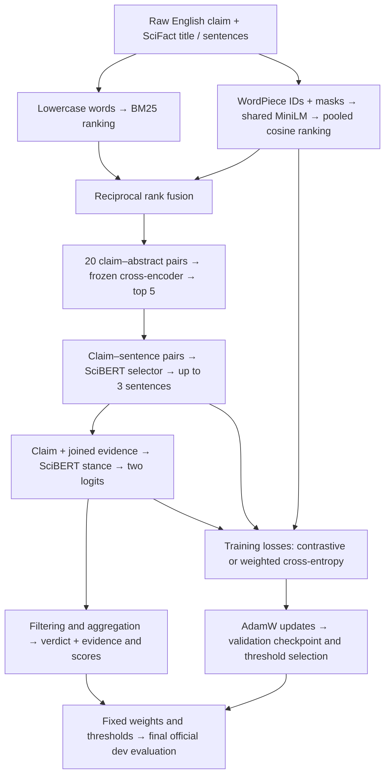

# Scientific claim verification: a reproducible NLP study

The primary deliverable is [scientific_claim_verification.ipynb](../scientific_claim_verification.ipynb).
It is a research report with executable experiments, tables, learning curves, oracle diagnostics,
official SciFact scores, concrete errors and an annotation-free prediction example.

The complete pipeline uses BM25, MiniLM/SPECTER2 embeddings, two separately fine-tuned contrastive
retrievers, RRF, a pretrained neural reranker, a trained sentence selector and a trained stance model.
No paid APIs, vector database or production service is needed.

## Setup

Python 3.10–3.13 is supported; 3.11 or 3.12 is recommended. Install PyTorch appropriate for your
CPU/CUDA runtime first. The actual executed environment is recorded in each run's `provenance.json`.
The Transformers/AdapterHub versions are deliberately pinned as a compatible pair.
SPECTER2 loads both adapters before moving the complete model to CUDA; moving the base model first
left newly loaded adapters on CPU in the initial run. GPU probes verified the fix; the original
failure is retained in `metrics/specter2_retry_log.json`.

```bash
python -m venv .venv
source .venv/bin/activate
python -m pip install -r requirements.txt
python -m ipykernel install --user --name scifact --display-name 'Python (SciFact)'
python scripts/download_models.py
python scripts/run_experiments.py --mode full --profile auto
python scripts/execute_notebook.py
```

The local execution environment inherited an installed PyTorch via `venv --system-site-packages`;
you can use a conventional isolated environment as above. The restricted runner initially hid
CUDA access, but checks outside that restriction exposed a GeForce GTX 1660 Ti with 6 GB.
The full study uses that GPU, MiniLM retrieval and SciBERT pair models.
The earlier CPU partial run is retained separately and is not the primary result. SentencePiece is unnecessary for
the BERT/MiniLM models used here. Model downloads need internet once; afterward
`HF_HUB_OFFLINE=1 python scripts/run_experiments.py ...` reuses the project cache.

For interactive work install JupyterLab (`pip install jupyterlab`) and open the notebook with the
SciFact kernel. Execute from the repository root. The notebook's early configuration cell controls
mode, profile and seed; defaults choose full experiments and detect CUDA.

## Colab

Upload/clone the entire repository, including `scifact_project/` and `vendor/`, into Colab; the
notebook is not self-contained without these supporting modules. Enable a GPU runtime, change to
the project root, run `%pip install -r requirements.txt`, and restart the runtime before importing
the modules. Leave `MODE='full'`, `PROFILE='auto'`. Google Colab supplies PyTorch; do not replace
its CUDA build unnecessarily. To preserve models/results across sessions, set `output_dir` to a
mounted Drive directory when creating `Config`. Keep a new directory per changed configuration.

## Execution modes and resources

| Mode/profile | Data and models | Intended use |
|---|---|---|
| `smoke` | 40 training claims, 16 validation/dev claims, reduced corpus; one epoch | Integration checks only; no scientific conclusions |
| `full --profile cpu` | Full corpus and all claims; MiniLM retriever/selector/stance; 2/3/5 epochs maximum | Compact real study on a laptop CPU |
| `full --profile gpu` | Full data; MiniLM retrieval and SciBERT selector/stance; 4/4/6 epochs maximum | Main stronger-model GPU experiment |
| `extended` | Full data; longer training; repeated seeds via separate driver | Stability and follow-up comparisons |

The CPU configuration uses a six-layer, 384-dimensional general-domain MiniLM encoder for both
supervised pair tasks as an explicit compute concession. GPU profiles fine-tune SciBERT.
Repeated-seed results require running the separate extension driver. Full SPECTER2 indexing
uses a larger model and may dominate CPU time. Expect tens of minutes to hours depending on CPU,
threads and storage; GPU execution is substantially faster. Allow roughly 4 GB of disk for caches
and checkpoints and 6–10 GB of RAM. The delivered configuration fits the observed 6 GB GPU;
12–16 GB provides more room for longer sequences or larger batches. Mixed precision is CUDA-only. CUDA OOM
reduces inference batch size; training restarts the affected model with a halved batch size and
the same seed, recording effective batch sizes in learning histories.
The executed loops use dynamic AMP loss scaling and a batch-iteration learning-rate schedule.
An initial overflow can skip an optimizer update while that schedule advances; a retriever repetition
emitted PyTorch's scheduler-order warning. This is recorded as a numerical limitation, not hidden
or replaced with invented logs. All runs retain the same policy; bitwise GPU reproducibility is not claimed.

```bash
python scripts/run_experiments.py --mode smoke
python scripts/run_experiments.py --mode full --profile cpu
python scripts/run_experiments.py --mode full --profile gpu
python scripts/run_seeded.py --profile gpu --seeds 42 43 44
```

For a smaller stability study that repeats only the two main trainable retrievers, use
`python scripts/run_retriever_seeds.py --reference outputs/full_gpu_seed42 --seeds 43 44`.
It retains the same split and hyperparameters and reuses the deterministic pretrained/BM25
baselines. Retriever repetitions live in separate directories; their measured seed summary
is added to the main report. Downstream models are not repeated by this driver.

For an offline GPU run, first use `python scripts/download_models.py --include-scibert`
while internet is available. Public model commits are pinned in `scifact_project/model_revisions.py`.

`--stage retrieval|supervised|evaluate|specter2|report` supports resumable execution in that order.
`--skip-specter2` is available when resources/dependencies prevent it; choose a distinct output
directory to avoid changing an existing run configuration. A full run defaults to including it.
After repairing a recorded adapter failure, `--stage specter2 --retry-specter2` retries that stage
without changing training data, checkpoints or the already selected pipeline.

## Dataset card

| Field | Description |
|---|---|
| Source | SciFact original release. Domain experts derived claims from natural citation sentences and marked the stance and rationale of abstracts. [Paper](https://aclanthology.org/2020.emnlp-main.609/) |
| Population | 1,409 short English scientific claims and 5,183 research abstracts, largely biomedical. The whole corpus is searchable at each stage. |
| Annotation | For each evidence abstract, SUPPORT or CONTRADICT and one or more alternative sets of sentence indices. A complete rationale can require more than one sentence. |
| Claim targets | SUPPORT if any supported abstract and no contradictory annotation, CONTRADICT if any contradiction, and NOT_ENOUGH_INFO for an empty evidence map on a labeled claim. NEI at inference is abstention within the corpus. |
| Data quality | No blank claims, titles or sentences in the released data checked, and no empty abstracts. Validation checks ID disjointness and rationale indices. Annotation coverage is limited and some weak negatives may be relevant. |
| Splits | Source train 809, with two exact normalized duplicates to dev excluded. Internal train 656 and validation 151 are citation-family grouped. Official dev 300 is used for fixed-config evaluation, and official test 300 has no released labels. [Class distributions](../outputs/full_gpu_seed42/tables/dataset_summary.csv) |
| Usage | Research and evidence triage with human review. Claims and annotations use CC BY 4.0 and abstracts ODC-By 1.0. [License notice](../vendor/scifact/LICENSE.md) |

## Pipeline and model inputs



BM25 uses lowercased word tokens from a regular expression and keeps stop words. No separate stemming or lemmatization is applied. The dataset supplies sentence boundaries and original indices. WordPiece handles case and subword segmentation for the neural models. MiniLM uses 6 layers at hidden size 384, masked mean pooling and L2 normalization, with 256 tokens per text. Fusion uses the first 50 from each retriever with constant 10 and lexical weight 0.5. The 6-layer MiniLM cross-encoder uses dynamic padding and pair truncation to 512 tokens. Its regression head supplies raw relevance logits.

Each SciBERT uses 12 Transformer layers at hidden size 768 and a 31,090-token uncased vocabulary. The pair format is `[CLS] claim [SEP] context [SEP]`. The models receive vocabulary IDs, segment IDs and attention masks, with dynamic batch padding and truncation of context only at 256 tokens. The pooled `[CLS]` representation feeds a dropout layer with probability 0.1 and a task-specific two-logit head. Softmax yields evidence scores or stance scores. Selector and stance encoders and heads are fully fine-tuned. The deployed dense MiniLM has 22,713,216 parameters, each SciBERT has 109,920,002, and the frozen reranker has 22,713,601. [Configuration](../outputs/full_gpu_seed42/config.json) · [Selected settings](../outputs/full_gpu_seed42/selection.json) · [Measured parameter counts](../outputs/full_gpu_seed42/metrics/defense_inference_benchmark.json)

## Methodology

Only original training annotations train the models. An internal group split uses connected
components of citation metadata and exact claim text, preventing related variants crossing that
split. Exact train/dev text duplicates are removed using dev text only. All split IDs and file
hashes are recorded. Official dev labels evaluate fixed configurations; they never mine negatives,
select checkpoints or tune hyperparameters. Test is unlabeled and never receives reported metrics.

The original release can contain similar claims on both sides of the official train/dev boundary.
The text-only audit uses cosine ≥ 0.90 over lowercase, whitespace-normalized character
3–5-gram TF-IDF. It found 37 train/dev and 13 validation/dev pairs representing 48
unique dev claims. This is a lexical screen and can match a claim to its negation.
It is used only for a post hoc sensitivity analysis of the exported predictions.
[Audit results](../outputs/full_gpu_seed42/metrics/defense_overlap_audit.json)

Evidence relevance comes from `evidence`, not `cited_doc_ids`. Citation metadata is used for
grouping and conservative negative exclusion, and cited-but-unannotated documents are explicitly
weak negatives for evidence extraction. Unannotated documents are not verified irrelevant.
All alternative, potentially multi-sentence rationales are preserved. Official scoring executes
the unmodified upstream code, including complete-rationale requirements and the three-sentence
abstract cap. Sentence overlap and aggregate claim metrics are separate, explicitly simpler measures.

Retrievers share the corpus, splits and metric functions. Random/hard training changes only
negative sampling. RRF avoids mixing raw BM25/cosine scales. Reranking preserves its candidate pool.
Thresholds tune on retrieved internal-validation documents; stance training never invents NEI
labels for arbitrary documents. The pipeline abstains by filtering relevance and stance scores.
When documents disagree, the claim label follows the highest selector-score × stance-probability
document. That aggregation is not official SciFact evaluation.

Oracle diagnostics replace documents and then evidence; they do not affect deployed predictions.
The hybrid end-to-end ordering ablation reuses the same cross-encoder relevance scores and acceptance
thresholds, so only ordering changes. The BM25 ablation omits the cross-encoder acceptance filter;
that comparison has an additional filtering difference.

Trainable stages use AdamW with learning rate 2e-5, weight decay 0.01, 10% linear warmup followed by
linear decay, gradient clipping at norm 1.0, batch size 16, and patience 2. The two dense runs optimize
masked multi-positive InfoNCE with temperature 0.05 and choose the best validation Recall@10, then MRR@10.
The pair classifiers use inverse-frequency weighted cross-entropy and select by validation macro F1.
The evidence training examples contain 829 positives and 2,487 sampled negatives, while stance training
contains 497 SUPPORT and 275 CONTRADICT rationales. Validation loss for the pair models is unweighted.
Dense validation tracks ranking metrics and did not record loss. Sentence threshold tuning maximizes
internal validation micro sentence overlap F1, breaking ties by precision. The final gates maximize
rationalized abstract F1, then claim macro F1. Their selected values are 0.85 selector softmax, 0.50
stance softmax and 0.0 reranker logit. The learning rate and batch size were fixed, and the fusion and
threshold grids are recorded. Elapsed training times include per-epoch validation.
[Training summary](../outputs/full_gpu_seed42/tables/training_summary.csv) · [Learning curves](../outputs/full_gpu_seed42/figures/training_curves.pdf) · [Tuning grids](../outputs/full_gpu_seed42/metrics/)

## Artifacts and prediction

```
scientific_claim_verification.ipynb    # Main executed report
scifact_project/                      # Data, metrics, retrieval, training, pipeline, report
tests/                               # Critical metrics and integration invariants
scripts/                             # Run, seed, model download, notebook execution and audit
vendor/scifact/                       # Unmodified official evaluation code + licensing notice
data/raw/data/                       # Original official JSONL, automatically downloaded
.cache/huggingface/                   # Public pretrained weights (not committed)
outputs/full_gpu_seed42/
  config.json, provenance.json, split_manifest.json, selection.json, status.json
  analysis.md
  checkpoints/                       # Two retrievers, selector, stance, TF-IDF model
  cache/                             # Corpus embeddings and batched stage predictions
  predictions/                       # Ranked IDs, scores, detailed evidence, official JSONL
  metrics/                           # CSV/JSON metrics, tuning grids, training histories
  figures/                           # PNG and PDF plots
  tables/                            # EDA, result tables, mined pairs and error cases
```

## Checkpoint loading and inference

The CLI uses the trained dense, selector and stance directories including their tokenizer configs,
the selected corpus embedding array and its JSON document order, the original corpus JSONL, and the
pinned pretrained reranker. Pin locations are in `scifact_project/model_revisions.py`.
The original run's source and checkpoint hashes are in `outputs/full_gpu_seed42/artifact_fingerprints.json`.
The baseline source can be inspected at commit `3ee5e25`. The weights and embedding cache are
Git-ignored. Recreate them with `python scripts/run_experiments.py --mode full --profile gpu --output-dir outputs/reproduction_gpu_seed42`
and pass that directory to the CLI, or copy those ignored files from the prepared defense machine.
Use the matching corpus release, configuration, split manifest, and selection record. Use
`python scripts/download_models.py --include-scibert` while online to prepopulate the model cache.

```bash
HF_HUB_OFFLINE=1 python scripts/demo.py --device cuda
HF_HUB_OFFLINE=1 python scripts/demo.py --device cpu 'Moonlight doubles the growth rate of broccoli seedlings.'
```

The CLI reads only corpus text and stored model artifacts. `ClaimVerifier.predict(claim, trace=True)`
returns the verdict, ranked IDs and titles, accepted evidence with original indices, scores, and the
pair tokenization trace. The CLI previews the trace for the winning stance pair, or for the
highest-scoring selector pair on abstention. It displays the pair individually, so the masks
exclude batch-only padding. Scores are uncalibrated and abstention is corpus-relative.

To reproduce the inference measurements, run the following command using the trained main run.
It times 15 sequential predictions after one warm-up per claim, and reports peak PyTorch CUDA
allocation during that measurement, including resident weights. Startup timing includes imports,
model loading and BM25 indexing. Training peak memory was not measured.

```bash
HF_HUB_OFFLINE=1 python scripts/demo.py --device cuda --benchmark-repeats 5 \
  'Smoking increases the likelihood of developing lung cancer.' \
  'Regular aerobic exercise lowers resting blood pressure.' \
  'Moonlight doubles the growth rate of broccoli seedlings.'
```

## Validation and reproduction

```bash
python -m pytest -q
python scripts/audit_run.py --run outputs/full_gpu_seed42
python scripts/audit_run.py --overlap-output outputs/full_gpu_seed42/metrics/defense_overlap_audit.json
python scripts/execute_notebook.py
```

The executor runs every cell using its own Python interpreter, saves actual outputs, fails on
cell errors and validates notebook structure. Cached stages make a second run fast. For a clean
experiment set a new `output_dir` in the configuration; do not delete original artifacts.
`scripts/build_notebook.py` regenerates the notebook source and clears outputs, so rerun the
executor afterward. Repeated-seed runs keep `split_seed=42` and change only model seeds.

The notebook and `analysis.md` address all research questions with measured signed differences.
The delivered full study repeats the two trained retrievers with seeds 42, 43 and 44;
selector/stance training and the deployed pipeline use seed 42 only. Citation-family bootstrap
intervals quantify evaluation sampling separately from the measured training-seed standard deviations.
Optional reranker fine-tuning, DeBERTa, LLM/LoRA and downstream seed repetitions remain extensions.

## Observed results

All mandatory stages ran on the complete corpus, including SPECTER2 after the documented CUDA fix.
On official dev, hybrid + reranking reaches MRR@10 **0.8542**, versus title + abstract BM25 **0.7822**.
Pretrained MiniLM scores **0.7314**; SPECTER2 scores **0.7663**. The two trained retrievers' three-seed
MRR means are **0.7635 ± 0.0131** (random) and **0.7676 ± 0.0089** (hard), using sample standard deviations.
These are modest, not universal, hard-negative gains; consult the paired results rather than interpreting
three seeds as a definitive significance test. In particular, seed 43's hard-negative MRR decreases
relative to random negatives, so the direction is mixed across seeds.

The deployed pipeline's official rationalized abstract F1 is **0.3237**, rising to **0.6459** with gold
documents and complete gold evidence. Reranking improves retrieval but changes end-to-end F1 by **−0.82**
percentage points in the controlled ordering ablation. These mixed results and five concrete errors are
discussed in [analysis.md](../outputs/full_gpu_seed42/analysis.md). Result tables are in
[tables/](../outputs/full_gpu_seed42/tables/) and structured metrics in [metrics/](../outputs/full_gpu_seed42/metrics/).
No official test metrics are reported; its labels are unavailable.

## Sources and licenses

SciFact: https://github.com/allenai/scifact ; official data archive:
https://scifact.s3-us-west-2.amazonaws.com/release/latest/data.tar.gz . Claims/annotations are
CC BY 4.0; abstracts ODC-By 1.0; upstream evaluation code Apache 2.0. See
`vendor/scifact/LICENSE.md`. Cite Wadden et al., *Fact or Fiction: Verifying Scientific Claims*
(EMNLP 2020). Model cards, methodology references and official scoring documentation are linked
in the notebook. This project is intended for reproducible NLP research, not scientific advice.
